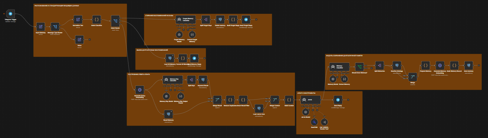
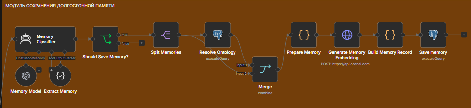
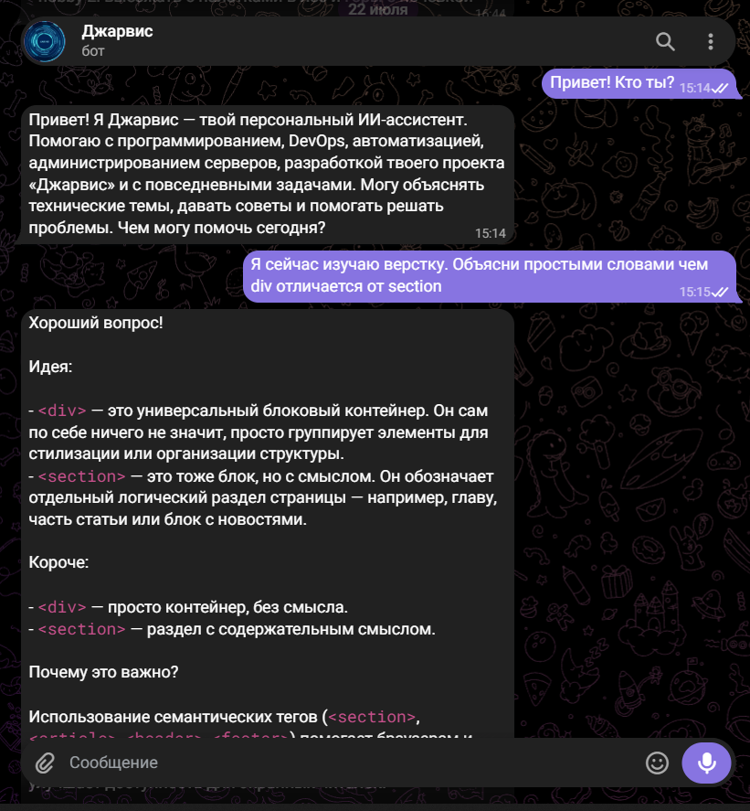
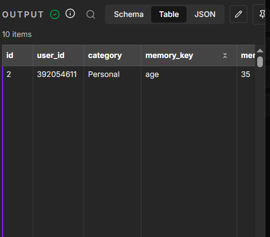

# JARVIS

> **Персональный AI-ассистент с долговременной памятью, модульной архитектурой и инструментами для выполнения задач.**

JARVIS — самостоятельный развиваемый проект на базе n8n, PostgreSQL, pgvector и OpenAI API. Он показывает мой практический подход к созданию AI-продуктов: объединение модели, данных, памяти, контекста и подключаемых инструментов в единую систему.

## О проекте

Цель JARVIS — создать персонального AI-ассистента, который способен:

- помнить пользователя и важные факты о нём;
- понимать контекст диалога;
- самостоятельно выбирать необходимые инструменты для решения задач;
- обучаться новой информации;
- автоматизировать повседневные действия;
- легко расширяться за счёт модульной архитектуры.

Проект развивается поэтапно. Каждый новый модуль интегрируется в существующую архитектуру без переписывания уже работающих компонентов.

---

# Реализовано

## JARVIS Core v1

- собственная личность ассистента (Identity);
- набор принципов работы (Principles);
- стиль общения (Response Style);
- централизованный System Prompt;
- хранение ядра в PostgreSQL;
- автоматическая сборка системного контекста.

---

## Long-Term Memory v2

- AI-классификация новых воспоминаний;
- атомарное хранение памяти (один факт — одна запись);
- семантическая онтология памяти;
- автоматическое разрешение синонимов (`resolve_ontology()`);
- сохранение новых фактов;
- обновление существующих фактов без дубликатов;
- удаление воспоминаний;
- гибридный поиск (Keyword + pgvector);
- Smart Recall Filter;
- автоматическое формирование пользовательского контекста.

---

## Инструменты (Tools)

- Telegram;
- Интернет-поиск (SearXNG);
- Docker Tool;
- SSH Tool.

---

## Автоматизация

- n8n Workflow;
- PostgreSQL;
- OpenAI API;
- Docker;
- Caddy Reverse Proxy.

---

# Архитектура обработки запроса

```text
Telegram
      │
      ▼
Input Gateway
      │
      ▼
Intent Router
      │
      ▼
Recall Memory
 ├── Keyword Search
 └── Vector Search
      │
      ▼
Merge Recall
      │
      ▼
Smart Recall Filter
      │
      ├────────────► Load JARVIS Core
      │
      ▼
Build Context
      │
      ▼
AI Agent
 ├── Memory Tool
 ├── SearXNG Tool
 ├── Docker Tool
 └── SSH Tool
      │
      ▼
Telegram Reply
```

---

# Скриншоты

## Общий Workflow



---

## Система долговременной памяти



---

## Telegram



---

## PostgreSQL



---

# Используемые технологии

| Категория       | Технологии          |
| --------------- | ------------------- |
| AI              | OpenAI GPT-4.1 Mini |
| Workflow        | n8n                 |
| База данных     | PostgreSQL 17       |
| Векторный поиск | pgvector            |
| Backend         | JavaScript          |
| Контейнеризация | Docker              |
| Веб-поиск       | SearXNG             |
| Сервер          | Ubuntu Server 24.04 |
| Reverse Proxy   | Caddy               |
| Контроль версий | Git + GitHub        |

---

# Структура проекта

```text
JARVIS/

├── architecture/
├── assets/
├── automation/
│   └── n8n/
│       └── workflows/
├── config/
├── core/
├── docker/
├── docs/
├── prompts/
├── scripts/
├── skills/
├── src/
├── tests/
├── CHANGELOG.md
├── CONTRIBUTING.md
├── LICENSE
└── README.md
```

---

# Roadmap

## Завершено

- [x] JARVIS Core
- [x] Long-Term Memory
- [x] Semantic Ontology
- [x] Hybrid Recall
- [x] PostgreSQL + pgvector
- [x] Telegram
- [x] Tool Calling
- [x] Docker Tool
- [x] SSH Tool

## В разработке

- PostgreSQL Tool
- File Tool
- GitHub Tool
- Health Tool
- Calendar Tool
- Универсальная система Skills

## Дальнейшее развитие

- Voice
- Vision
- Web UI
- Local LLM (Ollama)

---

# Статус проекта

🟢 **JARVIS Core v1 завершён.**

На текущий момент реализованы:

- централизованное AI-ядро;
- долговременная память;
- семантическая онтология;
- гибридный поиск воспоминаний;
- автоматическая сборка контекста;
- Tool Calling;
- Telegram-интерфейс;
- Интернет-поиск;
- Docker Tool;
- SSH Tool.

Следующий этап разработки — расширение экосистемы инструментов и развитие новых модулей без изменения базовой архитектуры.

---

# Автор

**Алексей Хорьяков**

Развиваю AI-продукты и приложения с использованием AI-assisted development, программирования и инженерного подхода. В JARVIS экспериментирую с архитектурой персонального ассистента, долговременной памятью, поиском по данным и инструментами. Описанные выше функции отражают текущий заявленный статус проекта; новые возможности добавляются поэтапно.
